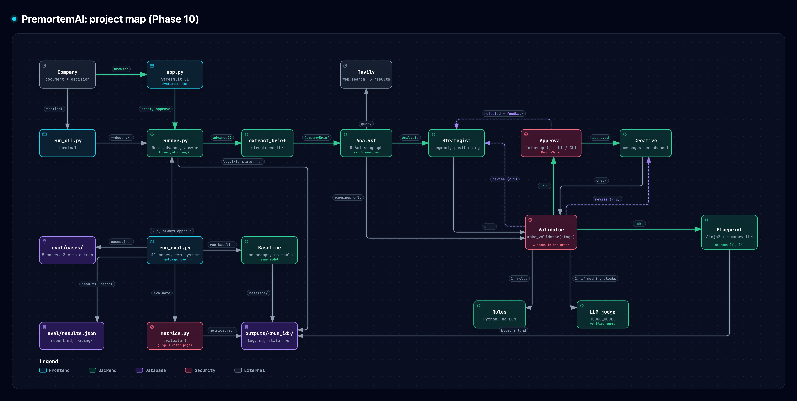

# PremortemAI

Agent-based premortem analysis: given a project document, the agents imagine
how the project failed and produce a structured report.

## Architecture

[](https://dario-marcolin.github.io/PremortemAI/architecture.html)

Document → `extract_brief` → Analyst (Tavily web search) → Strategist ⇄ Validator →
human approval → Creative ⇄ Validator → Launch Blueprint. The evaluation harness runs the
same pipeline against a single-prompt baseline.

[Interactive map](https://dario-marcolin.github.io/PremortemAI/architecture.html)
(zoom, search, light/dark theme; source: [docs/architecture.html](docs/architecture.html)).

## Team and roles

- **A** – project setup, core pipeline
- **B** – review and integration
- **C** – documentation and evaluation

## Setup

```bash
uv sync
cp .env.example .env   # then fill in LLM_API_KEY and TAVILY_API_KEY
```

`.env` is git-ignored: never commit real keys.

Smoke test:

```bash
uv run python -c "from premortem.llm import get_llm; print(get_llm().invoke('hello'))"
```

## Run

In the browser: upload a document (or pick one from `data/demo/` or `eval/cases/`), follow
the run log, approve or reject the strategy, download the blueprint. At the end the
**Evaluation** tab scores the blueprint (traceability, faithfulness, coherence, trap, cost)
and can compare it with the single-prompt baseline:

```bash
uv run streamlit run app.py
```

Full pipeline from the terminal (pauses for your approval of the strategy):

```bash
uv run python scripts/run_cli.py --doc data/demo/demo_company.pdf
uv run python scripts/run_cli.py --doc data/demo/demo_company.pdf --auto-approve
uv run python scripts/run_cli.py --doc data/demo/demo_company.pdf --reject "Target vegans"
```

At `Approve? [y/n/feedback]`, `y` approves and any other text rejects the strategy with
that feedback. Both write the same files to `outputs/<run_id>/`: `log.txt` (every step, as
the run goes), `blueprint.md` (the Launch Blueprint), `state.json` and `run.json`. To re-render
the blueprint of a saved run:
`uv run python tests/run_blueprint.py --run outputs/<run_id>`.

Offline tests (fake LLMs, no API credits): `uv run pytest`.

## Evaluation

Runs the pipeline (auto-approve) and a single-prompt baseline (same model, same document,
no tools, no validator) on every case of `eval/cases/`, scores both and writes
`eval/report.md`:

```bash
uv run python -m eval.run_eval                        # all cases, both systems
uv run python -m eval.run_eval --cases nordbrew_de    # some cases
uv run python -m eval.run_eval --report-only          # rebuild the report (e.g. after the human rating)
```

Metrics are defined in `eval/metrics.py`; the blind human rating is in `eval/rating/` (see
its README).

## Roadmap

See the project roadmap (link TODO).
